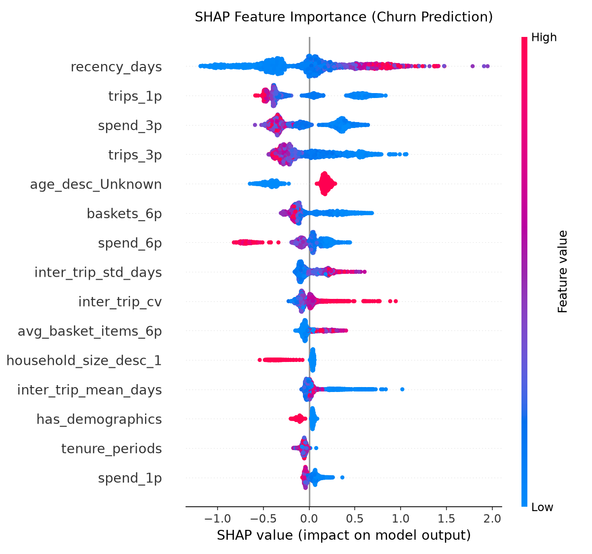

# Retention Radar

[](pyproject.toml)
[](https://github.com/sanjayBahadur/retention-radar/actions)
[](LICENSE)

An industrial-grade customer retention and causal optimization platform built on 2.6 million transactions across 2,500 households over 102 weeks (Dunnhumby corpus). The architecture combines discrete-time Markov chains, machine learning churn prediction, causal uplift modeling, and merchandise basket affinity tracking.

---

## Analytical & Engineering Highlights

- **Predictive Churn Discrimination:** Optuna-tuned LightGBM achieves a Test PR-AUC of **0.3370** ($95\%$ household-clustered CI: $[0.300, 0.380]$), performing comparably to regularized logistic regression (**0.3199** $[0.282, 0.362]$) with overlapping confidence intervals, while providing calibration gains (ECE **0.0091 vs 0.0104**) and top-decile lift (**4.64x vs 4.51x**). In the top 20% outreach bracket, LightGBM captures **73.88% of all churners**.
- **Quantified Business Impact:** Targeting the top 20% highest-risk households yields **+$96,962 net margin per 26-week cycle** ($+\$193,923$ annualized) per 100,000 households ($100\text{k HH} \times 7.58\% \text{ churn} \times 73.88\% \text{ capture} \times 10\% \text{ save rate} \times \$244.57 \text{ CLV} - 20\text{k contacted} \times \$2.00$).
- **Early-Warning Basket Contraction (Observed Association):** Lapsing households exhibit an 8-week precursor phase prior to dormancy, characterized by steep declines in center-of-plate proteins (**poultry -76.2%**, **beef -64.0%**) and infant essentials (**diapers -66.1%**).
- **Causal Uplift & Intervention Policy:** Benchmarked against randomized trials (Hillstrom and X5 RetailHero), an S-Learner identifies a top-30% uplift segment delivering **+$20,435 in net profit** (3.61x ROI over random contact), alongside 202 accounts (2.1%) with negative point-estimate treatment effects ("Sleeping Dogs").
- **Production Rigor:** 65 unit and integration tests (**93% test coverage**), zero-leakage rolling-origin temporal splits, 16 Pandera runtime schema contracts, and Population Stability Index (PSI) drift tracking.

<p align="center">
  
  <br>
  <em>SHAP TreeExplainer feature attribution: recency, trailing spend collapse, and trip velocity dominate churn probability.</em>
</p>

---

## Quickstart

### Option A: Docker Compose (Zero Environment Setup)
```bash
docker compose up
# Open http://localhost:8501 for the Streamlit Executive Command Center
```

### Option B: Local Python Environment
```bash
git clone https://github.com/sanjayBahadur/retention-radar.git
cd retention-radar

# Create virtual environment and install dependencies
python3.12 -m venv .venv
source .venv/bin/activate
pip install -e ".[dev]"

# Run tests and verify coverage (65 tests in ~30s)
make test

# Launch Streamlit application
make app
```

---

## Core Deliverables

- **[Interactive HTML Report](docs/index.html):** Zero-dependency standalone executive report with embedded Plotly charts (ready for GitHub Pages).
- **[Tableau & Power BI Starter Package](bi/README.md):** Production star-schema data model, clean BI marts, and 10 ready-to-use DAX and Tableau calculated measures.
- **[Executive Summary Brief](reports/executive_summary.md):** 1-page memo for marketing and merchandising leadership.
- **[Technical Report](reports/technical_report.md):** Mathematical formulations, proofs, clustered bootstrap evaluations, and fairness audit tables.
- **[Production Model Cards](reports/model_cards/):** Specifications for [Churn](reports/model_cards/churn.md), [Uplift](reports/model_cards/uplift.md), and [CLV](reports/model_cards/clv.md).

---

## Limitations & What I Would Do Differently

Senior practitioners recognize that analytical architectures operate under real-world constraints:

1. **Unobserved Competitor Switching:** Because Dunnhumby data comes from a single retail chain, we observe basket contraction (e.g. ceasing diaper or meat purchases) within our stores, but cannot observe whether shoppers moved to a discount competitor or changed household habits. Incorporating third-party syndicated consumer panel data (Numerator, Circana) is needed to distinguish true competitor defection from category category-switching.
2. **Observational Uplift Confounding:** The observational Qini score ($0.67$) is substantially higher than the randomized benchmark (X5 Qini $0.054$). In historical campaigns, marketing teams targeted responsive households, introducing selection bias that propensity trimming cannot entirely eliminate. Promotional suppression should never be hard-coded without continuous randomized holdout experiments.
3. **Markov Absorbing State Simplification:** Treating "Lapsed" (3 missed periods) as absorbing simplifies the fundamental matrix, but in reality 20.3% of lapsed households eventually return. A recurrent or semi-Markov renewal framework would better model winback dynamics.
4. **Demographic Subgroup Sample Sizes:** Removing demographic features eliminated proxy bias and improved cardholder recall, but individual demographic subgroups contain only 8 to 18 churners each. Larger stratified cohorts are required before drawing definitive statistical fairness conclusions.

---

## License

This project is licensed under the [MIT License](LICENSE).  
Developed by **Sanjay Bahadur** (`mallasanjay2099@gmail.com`).
